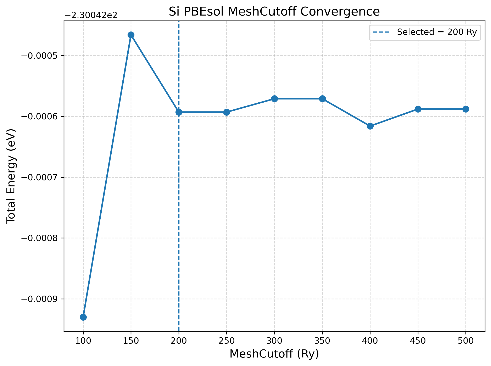
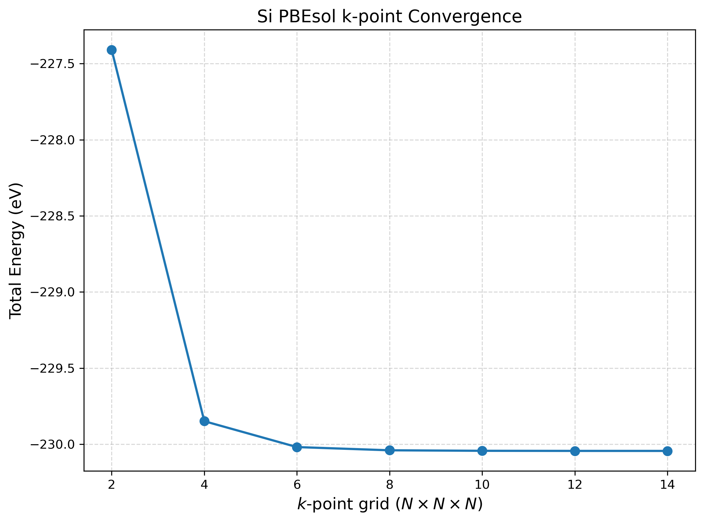
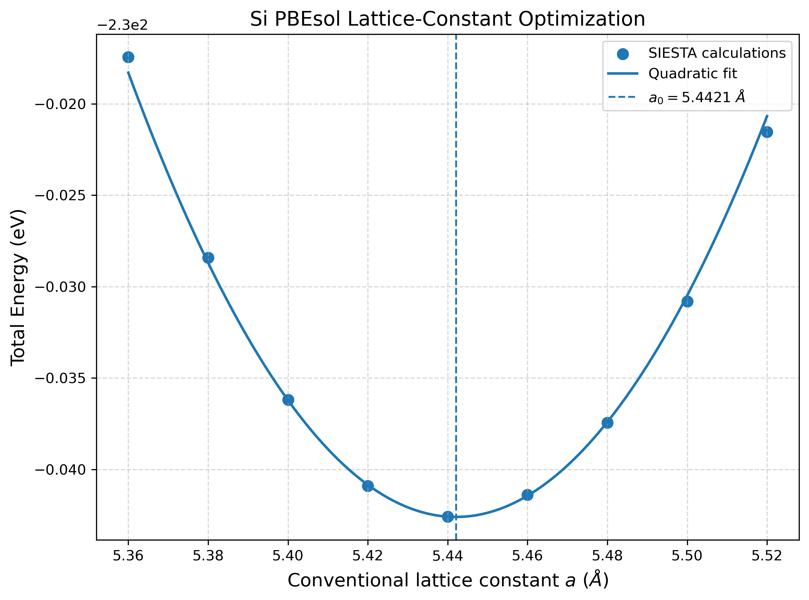

# Test numerical convergence

Change one numerical setting at a time while keeping the physical system fixed. The archive contains three scan tables and their original figures: mesh cutoff, k-point sampling and the conventional lattice parameter.

## Mesh, k-points and basis are different checks

`MeshCutoff` controls the real-space integration grid. The k-grid samples reciprocal space. The DZP basis describes the orbitals. Converging one does not converge the other two.

The supplied mesh scan fixes the k-grid at 10×10×10 and the cubic lattice parameter at 5.44 Å. The supplied k-point scan uses 400 Ry. Both use `DM.Tolerance 1.0d-5`; the final SCF and relaxation inputs tighten this to `1.0d-7`.

## 1. Compare the mesh-cutoff scan

Use the highest sampled cutoff, 500 Ry, as the comparison reference. Define `ΔE = E(setting) − E(reference)`. The sign is retained; for a tolerance use its absolute value.

| MeshCutoff (Ry) | Energy (eV / two-atom cell) | ΔE versus 500 Ry (meV / cell) |
| --- | --- | --- |
| 100 | -230.042930 | -0.342 |
| 150 | -230.042466 | +0.122 |
| 200 | -230.042593 | -0.005 |
| 250 | -230.042593 | -0.005 |
| 300 | -230.042571 | +0.017 |
| 350 | -230.042571 | +0.017 |
| 400 | -230.042616 | -0.028 |
| 450 | -230.042588 | 0.000 |
| 500 | -230.042588 | 0.000 |



The author selected 200 Ry. It differs from the 500 Ry value by 0.005 meV per cell in this table, and subsequent mesh settings fluctuate slightly. This is an energy check for this fixed geometry. It does not demonstrate force or stress convergence for an arbitrary system, and does not justify a universal 200 Ry recommendation.

Real-space grid integration need not yield a strictly monotonic energy curve. Do not choose the most negative point automatically. For accurate relaxation, repeat convergence checks for forces and stress as well.

## 2. Compare the k-point scan

Use 14×14×14 as the highest sampled reference. Two atoms per cell means a meV/cell difference is divided by two to get meV/atom.

| k-grid | Energy (eV / cell) | ΔE (meV / cell) | ΔE (meV / atom) |
| --- | --- | --- | --- |
| 2×2×2 | -227.409044 | 2634.338 | 1317.169 |
| 4×4×4 | -229.848165 | 195.217 | 97.6085 |
| 6×6×6 | -230.018149 | 25.233 | 12.6165 |
| 8×8×8 | -230.039232 | 4.150 | 2.075 |
| 10×10×10 | -230.042616 | 0.766 | 0.383 |
| 12×12×12 | -230.043250 | 0.132 | 0.066 |
| 14×14×14 | -230.043382 | 0.000 | 0.000 |



A 10×10×10 mesh passes an illustrative 1 meV/atom energy threshold against the largest sampled mesh. That threshold is a teaching choice, not a stated experimental error bar or proof that band edges, optical properties and stress are equally converged.

## 3. Find the lattice minimum

The lattice scan fixes the 10×10×10 grid and 200 Ry cutoff. Each point is an SCF calculation at a different cell size. There is no cell relaxation within each point.

| Cubic a (Å) | LatticeConstant (Å) | Energy (eV / cell) |
| --- | --- | --- |
| 5.36 | 2.68 | -230.017451 |
| 5.38 | 2.69 | -230.028411 |
| 5.40 | 2.70 | -230.036189 |
| 5.42 | 2.71 | -230.040895 |
| 5.44 | 2.72 | -230.042593 |
| 5.46 | 2.73 | -230.041379 |
| 5.48 | 2.74 | -230.037436 |
| 5.50 | 2.75 | -230.030805 |
| 5.52 | 2.76 | -230.021541 |



The original plotting script fits the five points from 5.40 through 5.48 Å to `E(a) = A a² + B a + C`. Its minimum is `a₀ = −B / (2A)`. Re-evaluating that fit from the supplied table gives `5.44206294 Å`, or `LatticeConstant = 2.72103147 Å`. The final supplied input uses 2.72105 Å, a nearby rounded choice.

This is a local quadratic interpolation, not a full equation-of-state analysis. The original plot extends the local polynomial over the entire shown range; avoid interpreting that extrapolation as additional calculated points.

## 4. Re-run the scans

From the course root:

```bash
python3 scripts/run_convergence.py mesh --np 4
python3 scripts/run_convergence.py kpoints --np 4
python3 scripts/run_convergence.py lattice --np 4
```

These helpers retain the original template settings, create a fresh directory for each scan and write `results.dat` after each completed point. They stop if MPI fails or the output lacks electronic convergence, normal completion or final energy.

For a tighter study, copy a template, change its DM tolerance deliberately and label the new results accordingly. Do not replace the reference tables with newly generated values from a different setup without recording that change.

## 5. Rebuild the supplied plots

If NumPy and Matplotlib are not available, create a small analysis environment:

```bash
python3 -m venv .venv
source .venv/bin/activate
python -m pip install numpy matplotlib
```

Then, for example:

```bash
cd reference/silicon-diamond/convergence/lattice
python3 plot_lattice.py
```

Each original plotting script reads its adjacent `.dat` file and writes a PNG. In a headless terminal use `MPLBACKEND=Agg python3 plot_lattice.py`. These plotting scripts analyse existing data; they do not run SIESTA.

## What still needs testing

There is no supplied SZ/DZP/TZP comparison or basis-confinement scan. For a research-quality accuracy assessment, converge the observable you will report: lattice parameters, forces, stress, band edges or energy differences. A small absolute energy change alone is not a complete uncertainty budget.

Continue to [relaxing the structure](relaxation.md).
